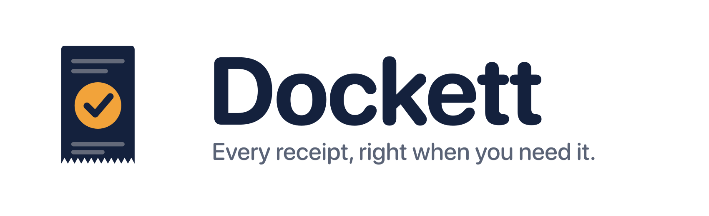
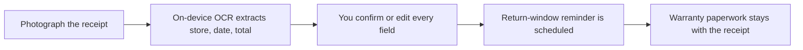

<div align="center">
  <picture>
    <source media="(prefers-color-scheme: dark)" srcset="branding/dockett-wordmark-on-dark.png">
    
  </picture>

  <p><strong>Every receipt, right when you need it.</strong></p>

     
</div>

> **Status: in design.** Dockett is a fully briefed and branded product concept. The plan, scope and open questions are documented; the app has not been built yet.

## The idea

Photograph a receipt and Dockett reads the store, date and total on the device, reminds you before the return window closes, and keeps the warranty paperwork together.

- **For:** Anyone who buys things and needs to return or claim warranty on them later.
- **Outcome:** When a return or warranty claim comes up, find the receipt in seconds and know the deadline.

## How it will work



## Planned features

- On-device text recognition (Apple Vision / VisionKit), no server and no third-party OCR
- Return-window and warranty reminders via local notifications
- Receipt and warranty paperwork kept together
- OCR output is treated as untrusted: every field is user-confirmed before saving
- No account, no analytics, no bank or email import

## Tech plan

| Layer | Choice |
|---|---|
| Language / UI | Swift, SwiftUI (iOS 17+) |
| Text recognition | Apple Vision / VisionKit (on-device) |
| Storage | Local (SwiftData or SQLite, TBD) |
| Reminders | Local notifications |
| Backend | None |

## Privacy by design

Receipt images and purchase totals never leave the phone. No account, no analytics, no server.

## Open decisions

Tracked openly in [`docs/PROJECT_BRIEF.md`](docs/PROJECT_BRIEF.md). A few of the big ones:

- How is the return window set: typed per receipt, picked from common presets, or both?
- Warranty paperwork: photos only, or PDFs and manuals too?
- Backup and device-to-device sync (iCloud?) vs. strictly local: this changes the privacy claim.
- Export format (PDF / CSV) and whether export is in v1.

## Brand

| | Name | Hex | Role |
|---|---|---|---|
|  | Ink | `#14213D` | Backgrounds, text, icon field |
|  | Paper | `#F6F1E7` | Receipt, light surfaces |
|  | Amber | `#F2A33A` | Accent, deadlines, key actions |
|  | Slate | `#5B6478` | Secondary text |

**Mark.** A paper receipt with a zig-zag torn edge and an amber check badge: kept, verified, handled.

**Voice.** Calm, plain and reassuring. Short sentences. Lead with the deadline or the answer, never with the feature.

Full logo set (mark, wordmark, app icon in light and dark) and the brand guide are in [`branding/`](branding/BRAND_GUIDE.md).

## Repository contents

```
docs/PROJECT_BRIEF.md   Confirmed requirements, assumptions, open questions, scope
branding/               Logo files and BRAND_GUIDE.md
```

## License

Proprietary. Shared publicly for portfolio and demonstration purposes only. See [LICENSE](LICENSE).

---

<div align="center">

Built by [Aquila Digital LLC](https://github.com/Steven6Brown) · *Per Aspera Ad Astra*

</div>
